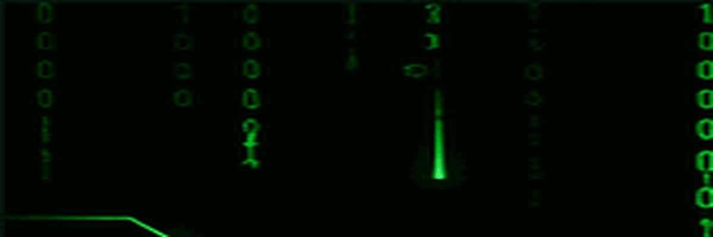

  

<h1 align="center">Hi 👋, I'm Kareem Mohsen</h1>

<h3 align="center">Front-End Developer | Computer Science & AI Graduate</h3>

  

---

### 👨‍💻 About Me

- 🎓 Computer Science & AI Graduate
- 💻 Interested in Front-End Development
- 🌱 Improving my skills in HTML, CSS and JavaScript
- 🎯 Building responsive and user-friendly websites
- 📍 Mit Ghamr, Dakahlia, Egypt

---

<h2 align="center">🛠️ Languages & Tools</h2>

  
  
  
  
  
  

---

---

<h2 align="center">📊 GitHub Statistics</h2>

  

<h2 align="center">💻 Most Used Languages</h2>

  

---

<h2 align="center">⚡ A Little More About Me</h2>

  🌐 Passionate about Web Development
   
  🎨 I enjoy creating clean and modern interfaces
   
  💡 Always exploring new technologies
   
  🧩 Focused on improving my problem-solving skills
   
  🚀 Building my journey as a Front-End Developer

---

<h2 align="center">🚀 Featured Project</h2>

<h3 align="center">📖 Quran Muslim</h3>

  

  

<h2 align="center">🌐 Connect With Me</h2>

  
  
  

---

## 🐍 Contribution Snake

  

---

  ⭐ Thanks for visiting my profile!

